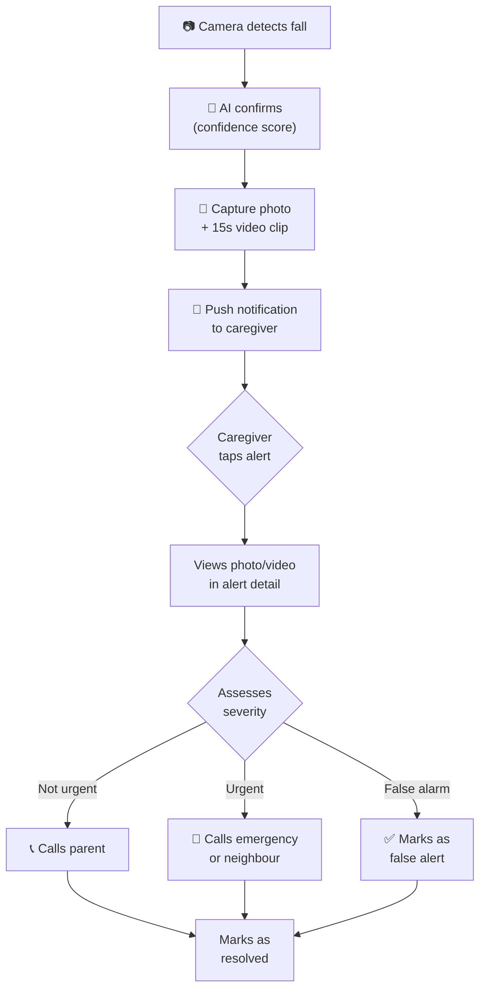

# Figma Prototype Prompt — Smart Elderly Home Monitoring

> Use this prompt as a design brief to build a clickable Figma prototype for the **Smart Elderly Home Monitoring** mobile app.

---

## 🎯 App Summary

A mobile app for **family caregivers** that receives real-time fall detection alerts from AI-powered cameras installed in an elderly relative's home. When a fall is detected, the caregiver instantly receives a **push notification with a photo or short video clip** of the incident, allowing them to assess the situation and respond.

**Primary user:** Family caregiver (views alerts, manages cameras, reviews history)
**Secondary user:** Elderly resident (consent setup only — no daily interaction required)

---

## 🎨 Design System

### Brand Identity

| Element | Value |
|---------|-------|
| **App Name** | SafeWatch / NiuCare *(pick one or placeholder)* |
| **Tagline** | "Peace of mind, one alert away" |
| **Tone** | Calm, reassuring, trustworthy — not clinical or alarming |
| **Style** | Clean, modern, minimal with rounded corners and soft shadows |

### Color Palette

| Role | Color | Hex | Usage |
|------|-------|-----|-------|
| Primary | Teal/Deep Cyan | `#0A8F8F` | Buttons, headers, active states |
| Primary Light | Soft Teal | `#E0F5F5` | Backgrounds, cards |
| Accent/Alert | Warm Red | `#E74C3C` | Fall alert badge, urgent notifications |
| Warning | Amber | `#F39C12` | Minor alerts, connectivity issues |
| Success | Green | `#27AE60` | "All clear" status, connected indicators |
| Neutral Dark | Charcoal | `#2C3E50` | Body text |
| Neutral Light | Light Grey | `#F4F6F8` | Screen backgrounds |
| White | Pure White | `#FFFFFF` | Cards, modals |

### Typography

| Element | Font | Size | Weight |
|---------|------|------|--------|
| App title | Inter / SF Pro | 28px | Bold |
| Screen heading | Inter / SF Pro | 22px | SemiBold |
| Section heading | Inter / SF Pro | 18px | SemiBold |
| Body text | Inter / SF Pro | 16px | Regular |
| Caption/meta | Inter / SF Pro | 13px | Regular |
| Button label | Inter / SF Pro | 16px | SemiBold |

### Corner Radius & Spacing

- Cards: `16px` radius
- Buttons: `12px` radius
- Input fields: `10px` radius
- Screen padding: `20px` horizontal
- Card spacing: `12px` gap

---

## 📱 Screen-by-Screen Specification

### Flow Overview

```
Onboarding → Dashboard (Home) → Alert Detail → Event History → Camera Management → Settings
```

---

### Screen 1: Splash / Onboarding (3 slides)

**Purpose:** Introduce the app to a new caregiver user.

````carousel
**Slide 1 — "Always Connected"**
- Illustration: caregiver on phone, elderly person at home with a subtle camera icon
- Headline: "Stay connected to your loved one's safety"
- Subtext: "Smart cameras with AI detect falls automatically"
- Button: `Next →`
<!-- slide -->
**Slide 2 — "Instant Visual Alerts"**
- Illustration: phone screen showing a notification with a photo thumbnail
- Headline: "See what happened, instantly"
- Subtext: "Receive a photo or video clip the moment a fall is detected"
- Button: `Next →`
<!-- slide -->
**Slide 3 — "Privacy You Control"**
- Illustration: camera icon with a shield/lock overlay
- Headline: "Privacy-first, consent-led"
- Subtext: "Cameras only capture clips during events. Your family controls what's shared."
- Button: `Get Started` (primary CTA)
````

---

### Screen 2: Sign Up / Login

**Layout:**
- App logo at top
- Tab toggle: `Sign Up` | `Log In`
- **Sign Up fields:** Full name, Phone number, Email, Password, Confirm password
- **Log In fields:** Email/Phone, Password
- `Forgot Password?` link
- Primary button: `Create Account` / `Log In`
- Divider: "or continue with"
- Social login buttons: Google, Apple

---

### Screen 3: Add Elderly Relative (Setup)

**Purpose:** Caregiver registers the elderly person they're monitoring.

**Fields:**
- Relative's name
- Relationship dropdown (Parent / Grandparent / Spouse / Other)
- Relative's phone number (optional — for contact)
- Home address
- Emergency contact (name + phone)
- Photo upload (optional profile picture of relative)

**Button:** `Continue to Camera Setup →`

---

### Screen 4: Camera Setup Guide

**Purpose:** Step-by-step walkthrough for installing cameras.

**Layout:** Stepper/progress bar at top (Step 1 of 3)

**Step 1 — Placement Guide**
- Illustration showing recommended camera locations (living room, hallway, kitchen)
- Checklist: ☑ Living room ☑ Hallway ☑ Kitchen ☐ Bedroom (optional)
- Tip card: "Place cameras at waist height for best fall detection"

**Step 2 — Connect Camera**
- QR code scanner UI to pair camera
- Status indicator: "Searching…" → "Connected ✓"
- Camera name field (e.g., "Living Room Camera")

**Step 3 — Test Detection**
- Live camera preview (placeholder frame)
- Button: `Run Test Fall Detection`
- Result: "✅ Detection working" or "⚠️ Adjust camera angle"

**Button:** `Finish Setup →`

---

### Screen 5: Consent Screen (Elderly Resident)

**Purpose:** Resident gives informed consent before monitoring begins. Shown on the **resident's device or caregiver's device during setup**.

**Layout:**
- Header: "Consent & Privacy Agreement"
- Icon: Shield with checkmark
- **Plain-language summary cards:**
  - 📷 "Cameras will be placed in: [Living Room, Hallway]"
  - 🔔 "Clips are captured ONLY when a fall is detected"
  - 👨‍👩‍👦 "Only [Caregiver Name] can view alerts and clips"
  - 🗑️ "Video clips are automatically deleted after 30 days"
  - ⏸️ "You can pause or remove cameras at any time"
- Checkbox: "I understand and agree to the monitoring arrangement"
- Signature field or `Confirm with PIN`
- **Buttons:** `I Agree` (primary) · `I Have Questions` (secondary — links to FAQ)

---

### Screen 6: Dashboard (Home Screen) ⭐

**Purpose:** Main screen the caregiver sees daily. Shows real-time status at a glance.

**Layout (top to bottom):**

1. **Top bar**
   - Greeting: "Hi, Faris 👋"
   - Profile avatar (top right)
   - Notification bell icon with red badge count

2. **Status Card (hero)**
   - Large card with green/red state
   - ✅ **All Clear:** "Mum is safe · Last activity 12 min ago" (green background)
   - 🚨 **Alert Active:** "Fall Detected! · 2 min ago" (red pulsing background)
   - Subtext: "2 cameras online · Living Room, Hallway"

3. **Quick Actions Row** (horizontal scroll)
   - 📷 `View Cameras`
   - 📞 `Call Mum`
   - 📋 `Event History`
   - ⚙️ `Settings`

4. **Recent Events Section**
   - Section header: "Recent Events" + `See All →`
   - Event cards (list):
     - 🔴 `Fall Detected` — "Living Room · Today 10:23 AM" — thumbnail
     - 🟡 `Unusual Inactivity` — "Hallway · Today 8:15 AM"
     - 🟢 `Motion Detected` — "Kitchen · Today 7:40 AM"

5. **Camera Status Section**
   - Mini camera cards showing:
     - Camera name + location
     - Status dot: 🟢 Online / 🔴 Offline
     - Last activity timestamp

6. **Bottom Navigation Bar**
   - 🏠 Home · 📋 History · 📷 Cameras · ⚙️ Settings

---

### Screen 7: Fall Alert Notification (Lock Screen + In-App)

**Push notification (lock screen):**
```
🚨 SafeWatch Alert
Fall Detected — Living Room
Mum may have fallen. Tap to view photo.
[Photo thumbnail]                    [View Now]
```

**In-app alert modal (full screen overlay):**
- 🔴 Red header bar: "FALL DETECTED"
- **Large photo/video** of the incident (takes up ~60% of screen)
- Play button overlay if video clip
- **Info row:** 📍 Living Room · 🕐 10:23 AM · ⏱️ 15 sec clip
- **Confidence badge:** "AI Confidence: High (92%)"
- **Action buttons (stacked):**
  - 📞 `Call Mum` (primary — full width)
  - 📞 `Call Emergency (999)` (red outline)
  - 👤 `Contact Neighbour` (secondary)
  - ✅ `Mark as Safe / False Alert` (text link)

---

### Screen 8: Alert Detail / Event Review

**Purpose:** Detailed view of a past or current alert event.

**Layout:**
1. **Photo/Video player** (top half)
   - Scrubber bar for video clip (10–30 sec)
   - Fullscreen toggle
   - Timestamp overlay on video

2. **Event Information Card**
   - Event type: Fall Detected
   - Location: Living Room Camera
   - Time: 26 Nov 2026, 10:23:07 AM
   - Duration: 15 seconds
   - AI Confidence: 92%
   - Status: ✅ Resolved / ⏳ Pending

3. **Response Log**
   - "10:23 AM — Fall detected by AI"
   - "10:24 AM — Alert sent to Faris"
   - "10:25 AM — Faris called Mum"
   - "10:27 AM — Marked as safe"

4. **Action buttons:**
   - `Download Clip` · `Share with Doctor` · `Delete Event`

---

### Screen 9: Event History

**Purpose:** Scrollable log of all past events.

**Layout:**
- **Filter bar:** All | Falls | Inactivity | Motion — Date range picker
- **Event list (cards):**
  Each card shows:
  - Event type icon + colour (🔴 fall, 🟡 inactivity, 🟢 motion)
  - Thumbnail photo (small, left side)
  - Location + timestamp
  - Status badge: Resolved / False Alert
  - Chevron → to detail view

- **Empty state:** "No events recorded yet. Your cameras are actively monitoring."

---

### Screen 10: Camera Management

**Purpose:** View, configure and manage installed cameras.

**Layout:**
- **Camera cards (vertical list):**
  Each card:
  - Camera name + location tag
  - Live preview thumbnail (static frame, not live video)
  - Status: 🟢 Online / 🔴 Offline / 🟡 Low Battery
  - Last event timestamp
  - Buttons: `View Feed` · `Settings ⚙️`

- **Camera Detail (on tap):**
  - Live preview (placeholder frame)
  - Detection zone overlay (adjustable rectangle on camera view)
  - Toggle: `Fall Detection` ON/OFF
  - Toggle: `Inactivity Alert` ON/OFF
  - Sensitivity slider: Low — Medium — High
  - Button: `Run Test Detection`
  - Button: `Remove Camera` (destructive, red text)

- **FAB (floating action button):** `+ Add Camera`

---

### Screen 11: Settings

**Sections (grouped list):**

| Section | Items |
|---------|-------|
| **Account** | Profile, Change password, Log out |
| **Monitored Person** | Name, photo, emergency contacts, medical notes |
| **Notifications** | Alert sounds, vibration, quiet hours, alert recipients |
| **Privacy & Storage** | Video retention period (7/14/30 days), auto-delete toggle, download all data, delete account |
| **Camera Defaults** | Default sensitivity, detection zones, night mode |
| **Consent** | View consent agreement, re-request consent, pause all monitoring |
| **Help** | FAQ, Contact support, Tutorial replay |
| **About** | App version, Terms of service, Privacy policy |

---

### Screen 12: Emergency Contact Management

**Layout:**
- Contact cards with: Name, Relationship, Phone, Priority order (drag to reorder)
- `+ Add Contact` button
- Toggle per contact: "Notify on fall alerts" ON/OFF
- Note: "Emergency contacts receive alerts if you don't respond within 5 minutes"

---

## 🔄 Key User Flows

### Flow 1: Fall Alert Response



### Flow 2: First-Time Setup

```
Open App → Onboarding slides → Sign Up → Add Elderly Relative
→ Camera Placement Guide → Pair Camera (QR) → Test Detection
→ Consent Screen (resident agrees) → Dashboard (ready)
```

### Flow 3: Review Past Event

```
Dashboard → Recent Events → Tap event card → View photo/video
→ Read response log → Download clip / Share / Delete
```

---

## 🧩 Component Library (Reusable)

Create these as Figma components for consistency:

| Component | Variants |
|-----------|----------|
| **Status Card** | All Clear (green) · Alert Active (red) · Camera Offline (yellow) |
| **Event Card** | Fall (red) · Inactivity (yellow) · Motion (green) · with/without thumbnail |
| **Camera Card** | Online · Offline · Low Battery |
| **Alert Button** | Primary (teal) · Destructive (red) · Secondary (outline) · Text link |
| **Notification Banner** | Critical (red) · Warning (amber) · Info (blue) |
| **Badge** | AI Confidence · Status (Resolved/Pending/False) · Count |
| **Bottom Nav** | Home · History · Cameras · Settings — active/inactive states |
| **Toggle** | ON (teal) / OFF (grey) |
| **Contact Card** | With/without alert toggle |

---

## 📐 Prototype Interactions

| Interaction | Type | Detail |
|-------------|------|--------|
| Onboarding slides | Swipe / tap | Horizontal carousel with dot indicators |
| Dashboard → Alert detail | Tap event card | Slide up transition |
| Fall alert modal | Auto-trigger | Overlay with dim background, slight scale-up animation |
| Video clip playback | Tap play button | In-line video player with scrubber |
| Camera test | Tap button | Loading spinner → success/warning result |
| Bottom nav | Tap | Switch screens with crossfade |
| Pull to refresh | Swipe down on dashboard | Refresh camera status and events |
| Mark as safe | Tap + confirm | Confirmation dialog → status change to "Resolved" |

---

## 📏 Frame Sizes

| Device | Frame |
|--------|-------|
| **Primary** | iPhone 15 Pro — 393 × 852 |
| **Secondary** | Samsung Galaxy S24 — 360 × 800 |
| **Optional** | iPad Mini (for dashboard-heavy view) |

---

## 📄 Prototype Pages (Figma Structure)

```
📁 Smart Elderly Home Monitoring
├── 📄 Cover Page (project info, team, date)
├── 📄 Design System (colors, type, components)
├── 📄 Onboarding Flow (3 slides + sign up/login)
├── 📄 Setup Flow (add relative + camera setup + consent)
├── 📄 Dashboard & Alerts (home, alert modal, alert detail)
├── 📄 Event History (list + detail view)
├── 📄 Camera Management (list + camera settings)
├── 📄 Settings & Contacts
└── 📄 Prototype Connections (flow arrows)
```

---

> [!TIP]
> **To speed up Figma work:** Start with the Dashboard and Fall Alert screens — these are the core experience. Use auto-layout for all lists and cards. Build the component library first, then assemble screens from components.
