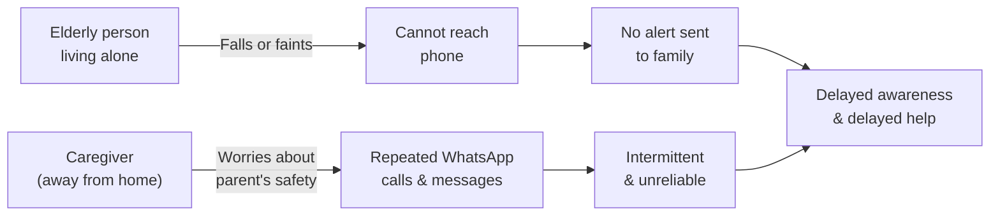
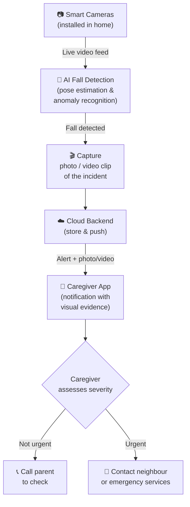
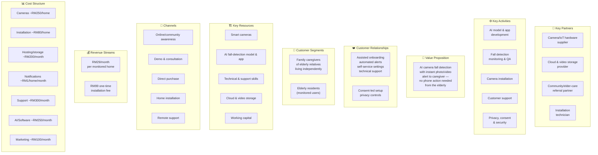

# Smart Elderly Home Monitoring

> **Team:** NiuTech
> **Course:** CGEB4123 — Technology Entrepreneurship
> **Members:** Faris Rezza bin Azlan (BSW01085218), Muhammad Zulfadhlin Iskandar bin Zulkifli, Muhammad Raisal Aziem bin Rosalan, Muhammad Ammar Afiq bin Nokman, Rozaili Mohamad Almusyammil bin Che Sub

---

## Overview

**Smart Elderly Home Monitoring** is a proposed camera-integrated home monitoring service designed for families with elderly relatives living independently in Malaysia. The system uses **smart cameras with AI-powered fall detection** to automatically identify when an elderly person falls — and immediately sends an **alert with a photo or video clip of the situation** to the family caregiver's mobile app, enabling them to assess the severity and respond appropriately — **without requiring the elderly person to operate a phone or press a button**.

> [!IMPORTANT]
> This is a proposed business concept developed through structured customer profiling and Business Model Canvas analysis. All claims are assumptions (A) or unresolved (U) unless otherwise noted — no field validation has been conducted.

---

## The Problem

### Identified Pain Points

| ID | Pain | Source |
|----|------|--------|
| **P1** | Caregivers may not know promptly when an elderly person experiences a fall or unusual event while alone | W1 Step 1 |
| **P2** | Repeated manual safety check-ins (calls/messages) consume caregiver time and provide only intermittent awareness | W1 Step 2 |
| **P3** | Phone-based communication fails when the elderly person cannot respond or reach a device during an emergency | W1 Steps 3 & 5 |
| **P4** | Residents may be concerned about privacy and inaccurate monitoring alerts *(new assumed pain)* | Derived |

### Current Alternatives & Limitations

- **WhatsApp/Telegram calls and messages** — depend on the elderly person responding
- **Scheduled visits by family or neighbours** — intermittent and not always feasible
- **Personal emergency alarms** — require the resident to press a button, which may not be possible during incapacitation

---

## The Solution

A **camera-integrated AI-powered home monitoring system** consisting of:

1. **Smart cameras with AI fall detection** installed in agreed areas of the home (living room, hallway, kitchen, etc.)
2. **On-device or cloud-based AI processing** that analyses video feeds in real time to detect falls and unusual events
3. **Automatic alert with visual evidence** — when a fall is detected, a photo or short video clip of the incident is captured and pushed to the caregiver
4. **Caregiver mobile app** for receiving alerts, viewing incident photos/videos, reviewing event history and managing settings

### Value Proposition

> *For family caregivers of elderly people living independently who need to maintain awareness of a parent's safety, our proposed Smart Elderly Home Monitoring service uses AI-powered cameras to automatically detect falls and immediately sends the caregiver an alert with a photo or video of the situation. Compared with calls and messaging alone, the caregiver can see what happened and assess the severity instantly — without requiring the elderly person to initiate contact.*

---

## Target Customers

### Primary: CS1 — Family Caregivers

| Attribute | Detail |
|-----------|--------|
| **Who** | Adult children / family caregivers in Malaysia responsible for an elderly parent living independently |
| **Role** | Primary buyer, dashboard user and decision maker |
| **Key Jobs** | J1: Know whether parent is safe while away · J2: Receive useful event information and decide on action |
| **Key Gains** | G1: Timely notification of unusual events · G2: Greater peace of mind while supporting independence |

### Secondary: CS2 — Elderly Residents

| Attribute | Detail |
|-----------|--------|
| **Who** | Elderly people living independently whose caregivers seek additional safety awareness |
| **Role** | Monitored user and essential **consent-giver** |
| **Key Jobs** | Remain independent at home with passive safety support |
| **Key Gains** | Independence, privacy and unobtrusive safety monitoring |

> [!NOTE]
> The elderly resident is not the primary paying customer but is an **essential stakeholder** — the system cannot be installed without their informed consent.

---

## Business Model Canvas

### BMC Component Summary

| Component | Entry | Status |
|-----------|-------|--------|
| **Customer Segments** | CS1: Family caregivers · CS2: Elderly residents (monitored users & consent-givers) | A |
| **Value Propositions** | VP1: AI camera-based fall detection with instant photo/video alert to caregiver app | A |
| **Channels** | CH1 awareness → CH2 demo → CH3 purchase → CH4 installation → CH5 support | A |
| **Customer Relationships** | CR1: Assisted onboarding + automated alerts + support · CR2: Consent-led setup | A |
| **Revenue Streams** | RS1: RM29/month subscription · RS2: RM99 installation (optional) | A/U |
| **Key Activities** | KA1 dev (AI model + app) · KA2 fall detection monitoring/QA · KA3 camera install · KA4 support · KA5 privacy/security/consent | A |
| **Key Resources** | KR1 smart cameras · KR2 AI fall-detection model & app · KR3 technical skills · KR4 cloud/storage · KR5 capital | A |
| **Key Partnerships** | KP1 camera/hardware supplier · KP2 cloud/storage provider · KP3 community referral · KP4 installation — *all proposed, none confirmed* | A/U |
| **Cost Structure** | CO1 cameras · CO2 installation · CO3 hosting/video storage · CO4 notifications · CO5 support · CO6 AI model/software · CO7 marketing | A |

---

## Customer Hypotheses

Three core hypotheses were formulated and reviewed:

| ID | Hypothesis | Decision | Priority |
|----|-----------|----------|----------|
| **H1** | Family caregivers of independently living elderly may experience significant worry when they cannot confirm a parent's safety during periods alone | **Retain** as assumption | High |
| **H2** | Caregivers may find repeated calls/messages an inefficient way to maintain safety awareness | **Refined** — focus on safety-checking burden only, not all communication | Medium–High |
| **H3** | Elderly residents may be unable to use phone-based communication during some emergencies, making camera-based automatic fall detection and visual alerts potentially more suitable than manual check-ins alone | **Retain** as assumption | High ⭐ |

> [!WARNING]
> **H3 is the most critical hypothesis.** The entire value proposition depends on AI cameras reliably detecting falls and capturing useful photo/video evidence. If detection accuracy is poor (missed falls or excessive false alerts), the core offering is weakened.

---

## Revenue & Cost Projections (Illustrative)

> [!CAUTION]
> All figures below are **planning estimates only** — no supplier quotes, market research or willingness-to-pay testing has been conducted.

### Revenue per Home

| Stream | Amount | Frequency |
|--------|--------|-----------|
| RS1 Subscription | RM 29 | Monthly |
| RS2 Installation | RM 99 | One-time |

### Cost Breakdown

| Item | Type | Estimate |
|------|------|----------|
| CO1 Smart cameras (AI-capable) | Variable (setup) | ~RM 250/home |
| CO2 Installation & setup labour | Variable (setup) | ~RM 80/home |
| CO3 Cloud hosting & video storage | Fixed (monthly) | ~RM 200 |
| CO4 Notifications/data | Variable (monthly) | ~RM 1/home |
| CO5 Support & maintenance | Fixed (monthly) | ~RM 300 |
| CO6 AI model & software maintenance | Fixed (monthly) | ~RM 250 |
| CO7 Marketing/outreach | Fixed (monthly) | ~RM 100 |

**Estimated recurring fixed costs:** ~RM 850/month (before hardware and installation)

---

## Coherence Checks ✅

| Check | Result |
|-------|--------|
| Each VP addresses a prioritised customer job/pain/gain | ✅ Yes — VP1 maps to J1/J2, P1/P2/P3, G1/G2 |
| Every segment has accessible channels and relationships | ✅ Yes, provisionally — reachability uncertain |
| Every revenue stream names a payer and value purchased | ✅ Yes — family caregiver pays; willingness unresolved |
| Resources and activities can deliver value | ⚠️ Uncertain — reliability needs technical assessment |
| Partnerships are labelled honestly | ✅ Yes — all marked proposed/potential |
| Cost estimates cover the delivery model | ⚠️ Partly — actual quotes and omitted costs remain |

---

## Unresolved Assumptions & Next Steps

| Assumption | Why It Matters | Owner | Priority |
|------------|---------------|-------|----------|
| **H3** — AI camera fall detection accuracy & photo/video capture | Core value depends on reliably detecting falls and sending clear visual evidence; must measure missed falls, false alerts and image quality | Technical Lead | 🔴 High |
| **H1** — Caregiver problem severity & willingness to adopt camera monitoring | Determines whether S1 is a viable target; privacy trade-off of cameras vs. value of visual evidence | Customer Research Lead | 🔴 High |
| Resident consent & privacy acceptance of in-home cameras | Installation requires informed consent; residents must accept camera placement, recording scope and data handling | Product/Privacy Lead | 🔴 High |
| Price & operating cost assumptions (higher due to cameras + video storage) | Subscription revenue must cover camera hardware, cloud video storage, AI processing, support and maintenance | Business Model Lead | 🟡 Medium |

---

## Key Design Principles

- **Passive** — no action required from the elderly person; the camera detects falls automatically
- **Visual evidence** — caregivers receive a photo or video of the incident to assess severity before responding
- **Consent-led** — cameras are installed only in agreed areas with the resident's informed consent; placement and alert rules are configurable
- **Transparent** — residents and caregivers agree on camera locations, what is recorded, who can view footage and how long it is stored
- **Honest** — no guaranteed emergency response times or life-saving claims are made
- **Privacy-aware** — video clips are captured only on fall events (not continuous livestream to caregiver), stored securely with access controls, and subject to data retention policies

---

> *This document is derived from the CGEB4123 Worksheet 2 structured analysis. All entries remain assumptions or unresolved hypotheses pending future validation.*
